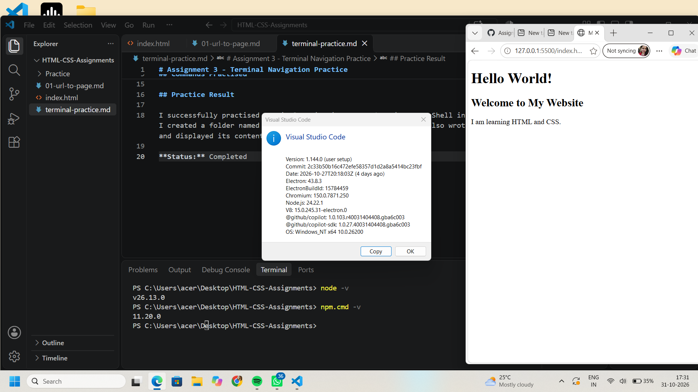

# Assignment 2 - Setup Proof

## Software Setup Verification

The following screenshot shows that I have successfully installed and tested:

- Visual Studio Code
- Node.js
- Live Server extension

Node.js and npm versions were checked in the VS Code terminal. I also successfully ran my HTML page using Live Server in the browser.

## Screenshot Proof

**Status:** Completed